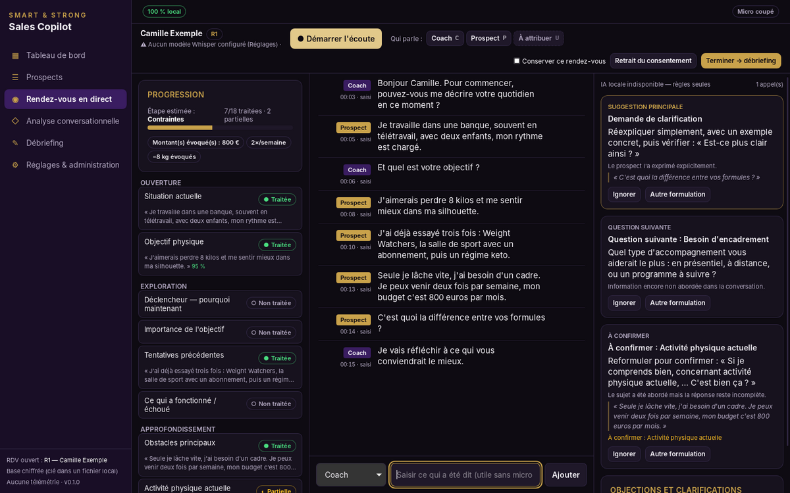

# Smart & Strong — Sales Copilot

Copilote commercial **local-first** pour les rendez-vous R1 (découverte) et R2 (présentation et décision) de Smart & Strong.
Application de bureau macOS (Tauri 2 + React + Rust), open source (MIT).

Pendant un rendez-vous **consenti**, l'application transcrit la conversation en français sur votre Mac, suit la progression
du questionnaire R1/R2, repère les objections explicites et les demandes de clarification, propose au maximum trois suggestions
courtes, puis génère un débriefing exportable (Markdown, PDF, JSON). Par défaut, **rien ne quitte votre ordinateur**.



## Ce qui fonctionne et ce qui a été vérifié

| | Vérifié |
|---|---|
| Moteur d'analyse (questions R1/R2, objections, suggestions, recommandation d'offre, préférences, débriefing, exports) | ✅ 35 tests automatisés |
| Backend Rust (base chiffrée, migrations, rétention, suppression, consentement, pipeline audio, barrière cloud, contrat Ollama) | ✅ 21 tests automatisés |
| Application complète (fiche → RDV → consentement → saisie → suivi → correction → débriefing → tableau de bord) | ✅ test de bout en bout sur l'application compilée (Linux) |
| Transcription Whisper réelle en français, micro macOS, Metal, Trousseau, `.dmg` | ⚠️ **à vérifier sur votre Mac** (non exécutable dans l'environnement de développement : ni Mac, ni micro, ni accès aux modèles) |

Détail complet : [docs/STATUS.md](docs/STATUS.md).

## Démarrage rapide (macOS)

```bash
cd sales-copilot
bash scripts/audit-mac.sh        # 1. audit de votre Mac (lecture seule) + recommandations de modèles
bash scripts/setup-mac.sh        # 2. installe ce qui manque (demande votre accord à chaque étape)
bash scripts/download-models.sh  # 3. modèle Whisper + modèle Ollama (seule étape qui nécessite Internet)
bash scripts/dev.sh              # 4. lance l'application
```

Pour construire l'application installable (`.app` + `.dmg`) : `bash scripts/build-mac.sh`.

Ensuite : [Guide d'utilisation](docs/USER_GUIDE.md) · [Dépannage](docs/TROUBLESHOOTING.md).

## Confidentialité en bref

- **Mode 100 % local par défaut** : Whisper (transcription) et Ollama (IA) tournent sur le Mac ; l'adresse d'Ollama est
  verrouillée sur `127.0.0.1`/`localhost` côté Rust.
- **Consentement obligatoire** avant toute écoute, vérifié par le backend ; retrait = arrêt immédiat.
- **Audio jamais écrit sur le disque** : transcrit en mémoire puis libéré.
- **Base SQLite chiffrée** (SQLCipher), clé dans le **Trousseau macOS**.
- **Conservation désactivée par défaut** : le contenu d'un rendez-vous est effacé à la fermeture, sauf choix explicite.
- **Cloud uniquement sur action explicite** (modes B/C) : prévisualisation, édition, masquage des noms/coordonnées,
  confirmation, journal des transferts (métadonnées seulement). Aucun basculement automatique.
- **Aucune télémétrie.**

Voir [docs/PRIVACY_RGPD.md](docs/PRIVACY_RGPD.md), y compris les points à faire valider (RGPD, données de santé).

## Structure

```
sales-copilot/
├── src/                     Interface React + TypeScript
│   ├── core/                Moteur métier pur (testé) : analyzer, objections, suggestions,
│   │                        recommendation, preferences, debrief, pdf, llm, cloud, offres, questionnaires
│   ├── screens/             Tableau de bord, Prospects, En direct, Analyse, Débriefing, Réglages
│   └── lib/                 Pont Tauri typé, store, base de connaissances
├── src-tauri/               Backend Rust
│   ├── src/                 audio (cpal + VAD), transcribe (whisper.cpp), db (SQLCipher), llm (Ollama/cloud),
│   │                        secrets (Trousseau), settings, commands
│   ├── migrations/          Migrations SQL versionnées
│   └── tests/               Tests backend
├── e2e/                     Test de bout en bout de l'application compilée
├── scripts/                 audit, installation, modèles, lancement, build
├── docs/                    Architecture, guide, RGPD, licences, dépannage, statut
└── config.example.json      Réglages initiaux (copiés au premier lancement s'ils sont placés en config.json)
```

## Tests

```bash
npm test                                   # moteur métier (Vitest)
cd src-tauri && cargo test                 # backend (Rust)
# Transcription réelle (sur le Mac, avec un modèle et un WAV français 16 kHz mono) :
WHISPER_MODEL=~/…/ggml-small.bin FR_TEST_WAV=exemple.wav FR_TEST_EXPECT="objectif,poids" cargo test -- --ignored
# Bout en bout (Linux + tauri-driver), voir l'en-tête de e2e/e2e_live_meeting.py
```

## Configuration

Les réglages sont modifiables dans l'application (Réglages & administration) et stockés dans la base chiffrée.
`config.example.json` montre tous les champs ; copié en `config.json` dans
`~/Library/Application Support/fr.smartandstrong.salescopilot/` **avant le premier lancement**, il sert de réglages initiaux.
Les offres, questionnaires R1/R2 et le texte de consentement sont modifiables depuis l'écran d'administration.

## Mise à jour

```bash
git pull
cd sales-copilot && npm ci && bash scripts/build-mac.sh
```

Les migrations de base de données s'appliquent automatiquement au lancement (`src-tauri/migrations`). Sauvegarde : fermez
l'application et copiez `copilot.db` ; la clé de chiffrement reste dans le Trousseau (entrée `fr.smartandstrong.salescopilot`).

## Licence

MIT — voir [LICENSE](LICENSE). Licences des dépendances et des modèles : [docs/LICENSES.md](docs/LICENSES.md).
